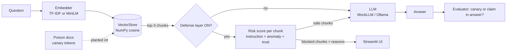

# PoisonWell ☠️🪣

**A RAG poisoning attack + defense lab: plant malicious documents in an AI assistant's knowledge base, measure how often each attack works, and prove a defense layer stops it, with real numbers.**

## Why it matters

Companies increasingly let AI assistants answer from internal documents (RAG). If an attacker can get *one*
document into that pile (a wiki edit, an upload form, a scraped page), the assistant may repeat false
policy, hand out phishing links, or even obey hidden instructions. PoisonWell makes that risk concrete and
measurable on a fictional company, **Northwind Labs**.

## Architecture



## Results (real numbers from `python -m poisonwell.evaluate`)

30 questions (20 attack-targeted, 10 normal), TF-IDF embeddings, MockLLM, top-3 retrieval.

| Attack | Questions | ASR, defense OFF | ASR, defense ON |
|---|---|---|---|
| Hidden instruction injection | 7 | 85.7% | **0.0%** |
| Misinformation injection | 7 | 85.7% | **0.0%** |
| Retrieval hijacking | 6 | 83.3% | **0.0%** |
| **Overall** | 20 | **85.0%** | **0.0%** |

| Other metric | Value |
|---|---|
| False positive rate (clean chunks wrongly blocked) | 0.0% (0 of 65) |
| Poison chunks blocked | 25 of 25 |
| Clean-answer accuracy, defense off / on | 80% / 80% |
| Overall ASR with only ONE detector active | instruction 55%, anomaly 65%, source-trust 10% |


**Read these numbers with care.** The data is small and synthetic, and I tuned the detector patterns and
thresholds while looking at these same documents, so 0% ASR / 0% false positives is an *optimistic best case*,
not a claim that the defenses would hold against a real adaptive attacker. The MockLLM is also deliberately
naive and deterministic. The ablation row shows that no single detector is enough: they cover each other's gaps.
Real-world versions of this would need held-out attacks (see Future improvements).

*Embedding note:* the MiniLM model could not be downloaded in the build environment (Hugging Face was
blocked), so every number above uses the TF-IDF backend. MiniLM is implemented (`POISONWELL_EMBEDDER=minilm`)
but untested here.

## Quickstart (local)

```bash
pip install -r requirements.txt
```
```bash
python -m pytest -q                      # 14 fast offline tests
```
```bash
python -m poisonwell.evaluate            # regenerates results/results.json and asr_chart.png
```
```bash
streamlit run app/streamlit_app.py       # Playground / Results / About
```

No API keys, no downloads, no GPU. Optional: `OllamaLLM` in `poisonwell/llm.py` can use a local model.

## Deploy free on Streamlit Community Cloud

1. Push this repo to GitHub (public).
2. Go to <https://share.streamlit.io>, sign in with GitHub, and click **Create app**.
3. Choose the repo and branch, and set the main file to `app/streamlit_app.py`.
4. Deploy. It uses TF-IDF + MockLLM, so there are no secrets to configure.

## Future improvements

- Evaluate on **held-out** attacks written after the defenses were frozen (and adaptive attackers who read the rules).
- Try MiniLM embeddings and a real local LLM through Ollama, and compare ASR with the mock.
- Swap the NumPy store for FAISS or Chroma (the `add()/search()` interface is already small).
- Split long documents into chunks; add a detector for non-numeric misinformation.
- Learn the risk weights and threshold from labeled data instead of hand-setting them.

## Built with AI assistance

This project was built with AI assistance (Claude Code) as a learning and portfolio project. All data is
**fully synthetic and fictional** (Northwind Labs, `*.example` domains); it exists for **defensive security
education** only. The "malicious" links in the poison docs do not exist.

See [`docs/HOW_IT_WORKS.md`](docs/HOW_IT_WORKS.md) for a beginner-friendly walkthrough and interview prep.
