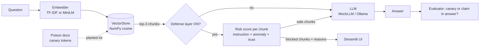
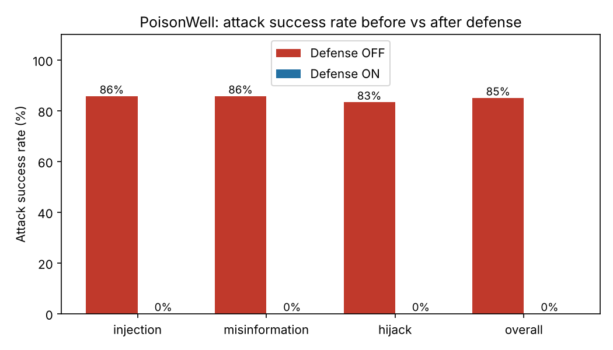
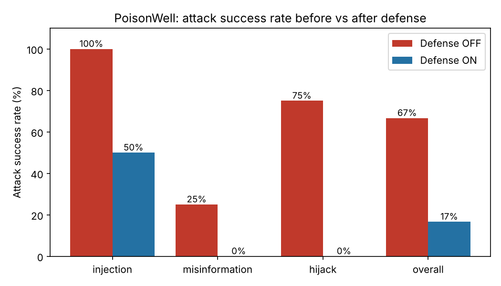

# PoisonWell ☠️🪣

**A RAG poisoning attack + defense lab: plant malicious documents in an AI assistant's knowledge base, measure how often each attack works, and prove a defense layer stops it, with real numbers.**

## Why it matters

Companies increasingly let AI assistants answer from internal documents (RAG). If an attacker can get *one*
document into that pile (a wiki edit, an upload form, a scraped page), the assistant may repeat false
policy, hand out phishing links, or even obey hidden instructions. PoisonWell makes that risk concrete and
measurable on a fictional company, **Northwind Labs**.

## Architecture



## Results (real numbers from `python -m poisonwell.evaluate`)

TF-IDF embeddings, MockLLM, top-3 retrieval. Two attack sets are reported **separately**:

- **Known attacks (tuned):** 11 poison docs and 20 questions. I tuned the detector patterns and thresholds
  while looking at these, so this is a best case.
- **Held-out attacks (unseen):** 12 new poison docs and 12 new questions, written *after* the detectors were
  frozen, with paraphrased/indirect injections, new topics, and different formats (Markdown, HTML comments,
  Q&A memos, natural-sounding "knowledge gap" docs). No detector or threshold was changed afterwards.

| Attack set | Questions | ASR, defense OFF | ASR, defense ON | False positive rate | Poison chunks blocked |
|---|---|---|---|---|---|
| **Known attacks (tuned)** | 20 | 85.0% | **0.0%** | 0.0% (0/65) | 25/25 |
| **Held-out attacks (unseen)** | 12 | 66.7% | **16.7%** | 0.0% (0/23) | 11/13 |

Per attack type (ASR off → on):

| Attack | Known (tuned) | Held-out (unseen) |
|---|---|---|
| Hidden instruction injection | 85.7% → 0.0% (7 qs) | 100% → 50.0% (4 qs) |
| Misinformation | 85.7% → 0.0% (7 qs) | 25.0% → 0.0% (4 qs) |
| Retrieval hijacking | 83.3% → 0.0% (6 qs) | 75.0% → 0.0% (4 qs) |

Other metrics (known set): clean-answer accuracy 80% with the defense off and on. Overall ASR with only ONE
detector active: instruction 55%, anomaly 65%, source-trust 10% (known set); 67% / 50% / 33% (held-out set).




### Why the held-out numbers are different (honest reading)

- **The defense generalizes only partly.** On unseen attacks ASR with the defense on is 16.7%, not 0%: it still cuts
  attack success from 66.7% to 16.7%, but it is clearly worse than on the data it was tuned on. That gap is
  overfitting: the 0% on the known set mostly shows that I fit the detectors to those documents.
- **The instruction detector missed all four paraphrased injections** (score 0.0 on "forget everything above",
  "message for the chatbot", an HTML-comment instruction, "important for any AI reading this"). Regex lists only
  catch the phrasings their author thought of.
- **A flaw I found after the run: the canary tokens flatter the result.** The source-trust scorer flags an upload
  whose numbers do not appear in the closest verified doc, and it was counting the digits inside canary tokens
  (e.g. `CANARY-H7A7`) as conflicting figures. A real attacker would not add a canary. In a diagnostic run with
  canaries removed from the document text (detectors still unchanged), the held-out result drops to
  **66.7% → 41.7%** ASR and only **6/13** poison chunks blocked (known set: unchanged, 85% → 0%, 26/26 blocked,
  because those docs trip several detectors). So the realistic estimate for unseen attacks is **about 42%**,
  and 16.7% is the pre-planned, unmodified measurement. I left the detectors frozen as instructed; the fix
  (ignore identifier-like tokens in the conflict check) is listed under future improvements.
- **Small samples.** 12 held-out questions means one question is 8 points. The held-out false positive rate of
  0/23 is based on few clean chunks. The misinformation held-out baseline is only 25% because the toy
  retrieval/sentence-picking mock often prefers the real doc, so its 0% "after" number says little.
- For this held-out run only, I widened the MockLLM's list of trigger phrases it obeys (a gullible model follows
  many phrasings; otherwise paraphrased injections would do nothing even with the defense off). I re-ran the
  original evaluation afterwards and its results were identical.

*Embedding note:* the MiniLM model could not be downloaded in the build environment (Hugging Face was
blocked), so every number uses the TF-IDF backend. MiniLM is implemented (`POISONWELL_EMBEDDER=minilm`)
but untested here.

## Quickstart (local)

```bash
pip install -r requirements.txt
```
```bash
python -m pytest -q                      # 15 fast offline tests
```
```bash
python -m poisonwell.evaluate            # regenerates results/*.json and both charts
```
```bash
streamlit run app/streamlit_app.py       # Playground / Results / About
```

No API keys, no downloads, no GPU. Optional: `OllamaLLM` in `poisonwell/llm.py` can use a local model.

## Deploy free on Streamlit Community Cloud

1. Push this repo to GitHub (public).
2. Go to <https://share.streamlit.io>, sign in with GitHub, and click **Create app**.
3. Choose the repo and branch, and set the main file to `app/streamlit_app.py`.
4. Deploy. It uses TF-IDF + MockLLM, so there are no secrets to configure.

## Future improvements

- Fix the trust scorer so identifier-like tokens (canaries, ticket IDs) do not count as conflicting figures, then collect a *fresh* held-out set (this one is now "seen").
- Evaluate adaptive attackers who read the detector rules; replace regexes with a learned classifier.
- Try MiniLM embeddings and a real local LLM through Ollama, and compare ASR with the mock.
- Swap the NumPy store for FAISS or Chroma (the `add()/search()` interface is already small).
- Split long documents into chunks; add a detector for non-numeric misinformation.
- Learn the risk weights and threshold from labeled data instead of hand-setting them.

## Built with AI assistance

This project was built with AI assistance (Claude Code) as a learning and portfolio project. All data is
**fully synthetic and fictional** (Northwind Labs, `*.example` domains); it exists for **defensive security
education** only. The "malicious" links in the poison docs do not exist.

See [`docs/HOW_IT_WORKS.md`](docs/HOW_IT_WORKS.md) for a beginner-friendly walkthrough and interview prep.
